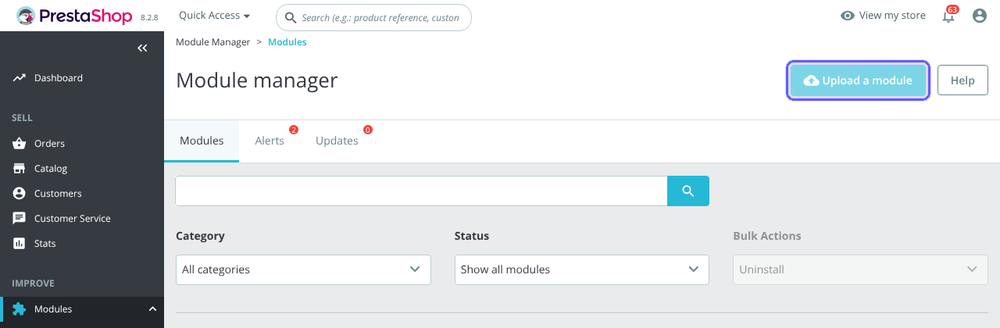
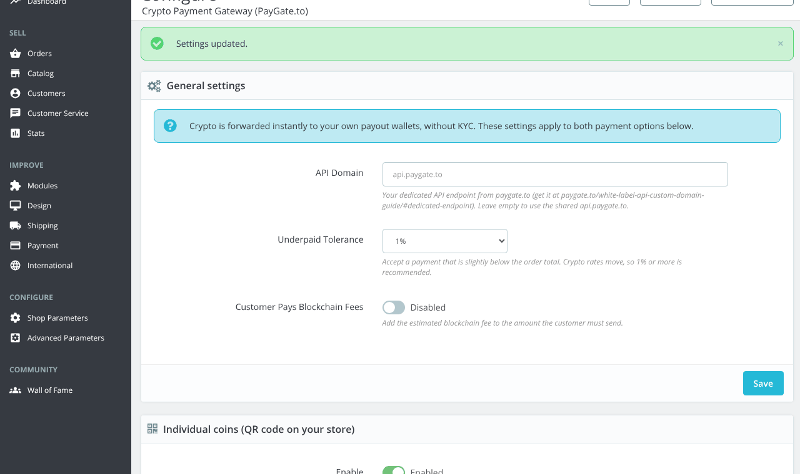
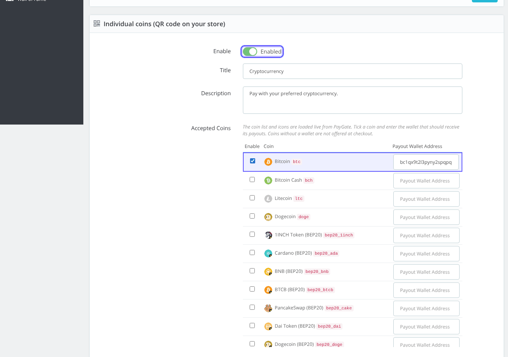
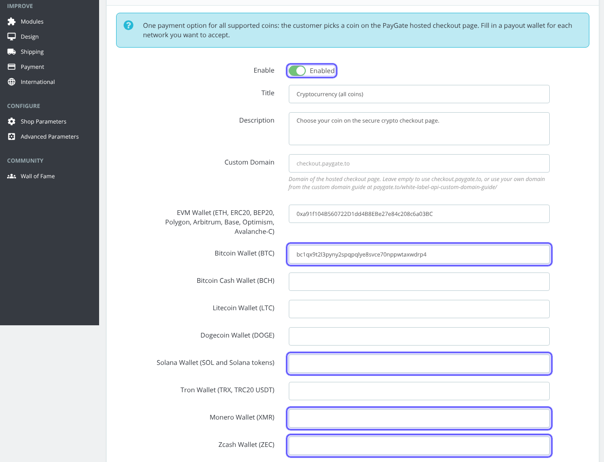
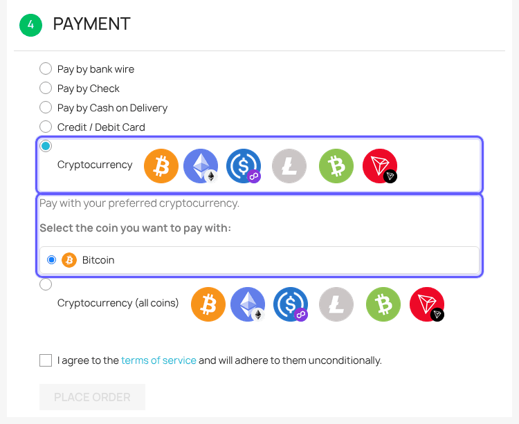
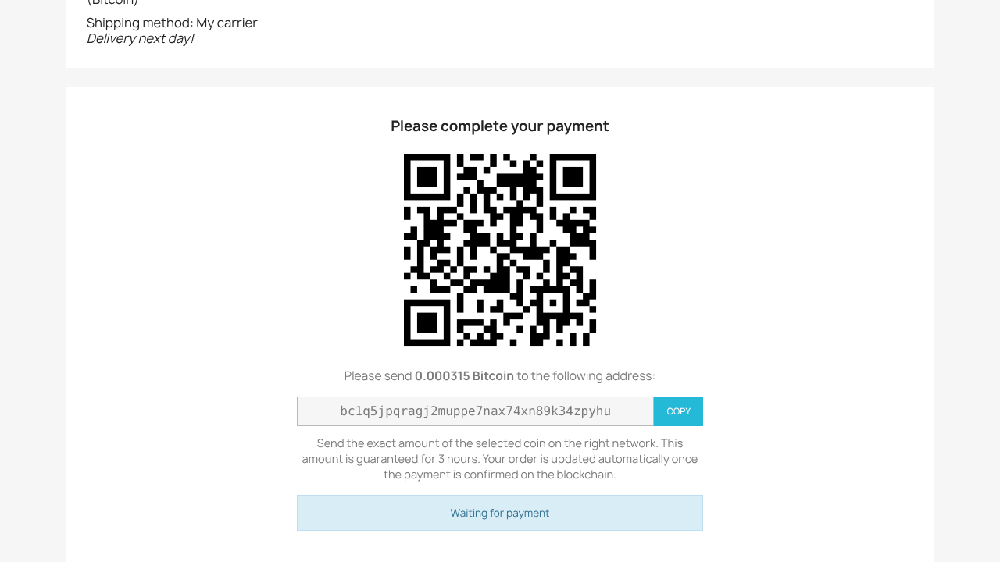
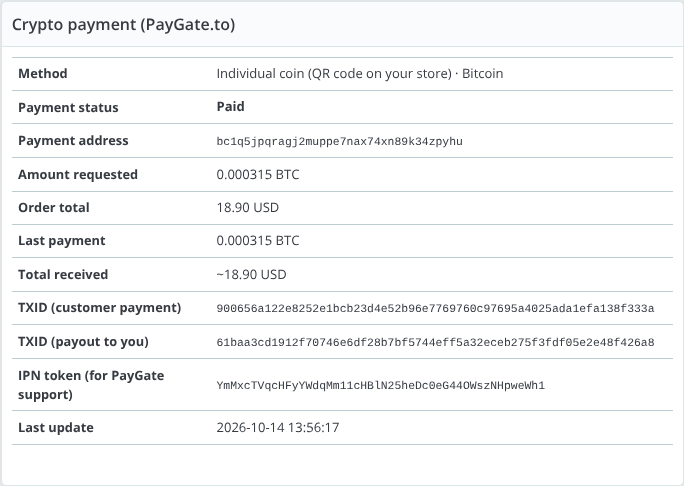

# prestashop-crypto-payment-gateway
PrestaShop crypto payment gateway with instant payouts. No KYC crypto payment gateway module for PrestaShop, self hosted on your PrestaShop store.

> **The only crypto payment gateway with instant payouts for Solana (SOL), Monero (XMR), Zcash (ZEC) and Bitcoin (BTC).**
> Every payment is forwarded straight to your own wallet the moment it is confirmed: no holds, no sign up, no KYC. The same support is built into all our plugins and modules: WooCommerce, WHMCS, OpenCart, PrestaShop and Magento.

## Features

- Accept **Bitcoin, Solana, Monero, Zcash, ETH, USDT, USDC** and hundreds of other coins and tokens on BTC, BCH, LTC, DOGE, ETH, ERC20, BEP20, Polygon, Arbitrum, Base, Optimism, Avalanche-C, Solana, Tron (TRC20), TON and more ([full list and minimums](https://paygate.to/crypto-payment-gateway-no-kyc-instant-payouts/#minimumorder)).
- **Instant payouts**: crypto is forwarded to your wallet the moment the payment is confirmed, with no delay or holds.
- **No KYC and no registration**: you and your customers stay anonymous.
- **QR code on your own site** with a unique address for every order, or one **Multicoin** option where the customer picks any coin on the hosted page.
- Payment confirmations signed by PayGate.to and verified by the module: orders are marked paid by themselves.
- Choose who pays the blockchain fee: you or the customer.
- If a customer sends the wrong token or uses the wrong network, supported tokens are still forwarded to you automatically.
- Works with your own checkout domain and a free dedicated API endpoint ([custom domain guide](https://paygate.to/white-label-api-custom-domain-guide/)).
- Fees: **1.5% flat rate + blockchain fees**.
- If the customer sends less than the order total, the rest can be sent to the same address and both payments are added up.

📘 **Step-by-step guide with screenshots:** [https://paygate.to/crypto-payment-gateway-no-kyc-instant-payouts/prestashop/](https://paygate.to/crypto-payment-gateway-no-kyc-instant-payouts/prestashop/)

## Requirements

- **PrestaShop 1.7.7 or newer** (tested on PrestaShop 8.2)
- A public shop with outbound HTTPS (the coin list is loaded live) and PHP OpenSSL
- With SSL: turn on both **Enable SSL** and **Enable SSL on all pages**
- A wallet address for each coin you want to accept

## Installation

1. **Prepare your wallets.** Crypto is forwarded to **your own wallet addresses**, one per coin or network: a Bitcoin address for BTC, a Solana address for SOL and Solana tokens, Monero and Zcash addresses for XMR and ZEC, and one `0x` address for ETH and all EVM networks (ERC20, BEP20, Polygon, Arbitrum, Base, Optimism, Avalanche-C). Use **self-custodial wallets** you control and **never exchange deposit addresses**.
2. **Download** [cryptopayment_gateway.zip](https://github.com/paygate-to/prestashop-crypto-payment-gateway/raw/refs/heads/main/cryptopayment_gateway.zip).
3. **Modules › Module Manager › Upload a module**, drop the zip and click **Configure**.

   

4. **General settings**: API Domain (leave empty for `api.paygate.to`), **Underpaid Tolerance** (1%) and **Customer Pays Blockchain Fees**.

   

5. **Individual coins**: enable it and tick each coin you want in **Accepted Coins** with its payout wallet.

   

6. **Multicoin (optional)**: enable it and fill in the payout wallets, including **Solana Wallet (SOL and Solana tokens)**, **Monero Wallet (XMR)**, **Zcash Wallet (ZEC)** and **Bitcoin Wallet (BTC)**. Click **Save**.

   

7. **Test**: the customer picks a coin at the payment step and sees the QR code, amount and address on the order confirmation page (also in **My account › Order history**).

   

   

8. When the payment is confirmed the crypto is forwarded to your wallet and the order moves from **Awaiting crypto payment** to **Payment accepted**. The admin order page shows a **Crypto payment (PayGate.to)** block.

   

## Settings

| Setting | Description | Default |
|---|---|---|
| Accepted Coins (Individual coins) | Tick a coin and enter its payout wallet. | none |
| Network wallets (Multicoin) | EVM, BTC, BCH, LTC, DOGE, SOL, TRX/TRC20, XMR, ZEC, TON. | empty |
| API Domain | Your dedicated API endpoint. | empty (uses api.paygate.to) |
| Custom Domain (Multicoin) | Domain of the hosted checkout page. | checkout.paygate.to |
| Underpaid Tolerance | Accept payments slightly below the total (0–10%). | 1% |
| Customer Pays Blockchain Fees | Add the estimated network fee. | Disabled |
| Logo URL, colours (Multicoin) | Branding of the hosted page. | empty |

Underpaid orders get **Payment error**; for individual coins the payment box asks the customer to send the rest to the same address. Payment confirmations are signed by PayGate.to, verified by the module, and still reach the shop in maintenance mode.

Full product page: [https://paygate.to/crypto-payment-gateway-no-kyc-instant-payouts/](https://paygate.to/crypto-payment-gateway-no-kyc-instant-payouts/) · Support: [Telegram](https://t.me/PayGate_to)
